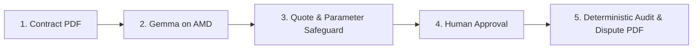

# CLAWBACK: 8-SLIDE PITCH DECK TRANSCRIPT

Designed for a 3-minute presentation or slide deck PDF submission.

---

### Slide 1: Title & Overview
- **Header**: **Clawback**
- **Tagline**: Find the money your carriers overcharged you, with proof.
- **Track**: Track 3: Reinvent Commerce
- **Platform**: Google Gemma-2-9B-IT on AMD ROCm Instinct GPUs
- **License**: Open Source (MIT)

---

### Slide 2: The Problem: Unchecked Carrier Spend
- **Billions in Unaudited Freight**: Shippers process thousands of complex line items each month; manual clause-by-clause contract auditing is prohibitively expensive.
- **Aggressive Deadlines**: Carrier dispute windows are statutory and tight (often only 15 to 90 days before claims expire).
- **Extortionate Contingency Fees**: Outsourced third-party audit firms take 20% to 50% of recovered dollars (vendor-sourced industry benchmark).

---

### Slide 3: Why Commerce? Margin Protection from the Cost Side
- **Commerce is More than Clicks**: True retail and e-commerce profitability hinges on supply chain margins. Freight spend represents 8% to 15% of cost of goods sold.
- **Pure Pre-Tax Bottom Line**: Every dollar recovered from carrier billing discrepancies drops directly into operating profit.
- **Auditable Capital**: Recovery funds returned to working capital without risking shipper-carrier relationships.

---

### Slide 4: How It Works: 5 Disciplined Steps

1. **Contract In**: Ingest PDF agreement.
2. **Extraction**: Gemma parses tariff discounts, accessorial caps, and fuel formulas.
3. **Safeguard Verification**: Verbatim quotes verified against PDF text; numbers checked against quotes.
4. **Human in the Loop**: Clerk approves verified rules.
5. **Deterministic Audit**: 100% pure Python `Decimal` audit matches invoice lines and drafts dispute letters.

---

### Slide 5: Rigorous Architectural Safeguards
- **Zero LLM Math**: Language models hallucinate arithmetic. Gemma never touches dollars or calculations; all amounts compute in pure Python `Decimal`.
- **Verbatim Text Grounding**: Rules without matching quotes in the PDF text layer are automatically rejected.
- **Parameter Validation**: Every numeric parameter must appear in the cited clause.
- **Human Authority**: No rule audits live invoices without explicit human sign-off; dispute letters are clerk-reviewed before export.

---

### Slide 6: Powered by AMD ROCm & Gemma-2-9B
- **High-Value GPU Workloads**:
  - **Self-Consistency ($k=3$)**: Runs 3 concurrent extraction passes on AMD ROCm; requires $\ge 2$ run consensus.
  - **Charge Normalization**: Classifies messy invoice abbreviations (`RESI DLVRY`, `LIFT GATE SVC`) to canonical whitelist.
- **Telemetry Transparency**:
  - Real-time AMD Panel reporting latency, tokens per second, and `last_live_call_timestamp`.
  - Dedicated *"Run Live Extraction Test"* button for judges.
  - Clear, honest `REPLAY` badge when offline.

---

### Slide 7: Verified Results (Synthetic Benchmark)
- **Dataset**: 1,250 invoice lines across 25 batches and 3 carrier contracts.
- **Recall**: **100.00%** (284 of 284 planted errors detected).
- **Precision**: **100.00%** (0 false positives).
- **Financial Match**:
  - Ground Truth Planted: **$9,130.51**
  - Clawback Recovered: **$9,130.51**
  - Variance: **$0.00 (0.00%)**
- **Speed**: **2.16 ms** average batch audit latency.

---

### Slide 8: Honest Limits & Product Roadmap
- **Current Limits**:
  - All benchmark data is synthetic; real-world carrier contracts remain untested.
  - Scanned image PDFs are unsupported (requires text PDF).
  - External published tariff tables are not yet indexed.
  - Dispute packages are drafted for clerk review; no automated carrier dispatch.
- **Commercial Roadmap**:
  - Carrier portal upload bots and EDI 210/214 integration.
  - Published base tariff lookup tables.
  - Pilot deployments with logistics design partners.
